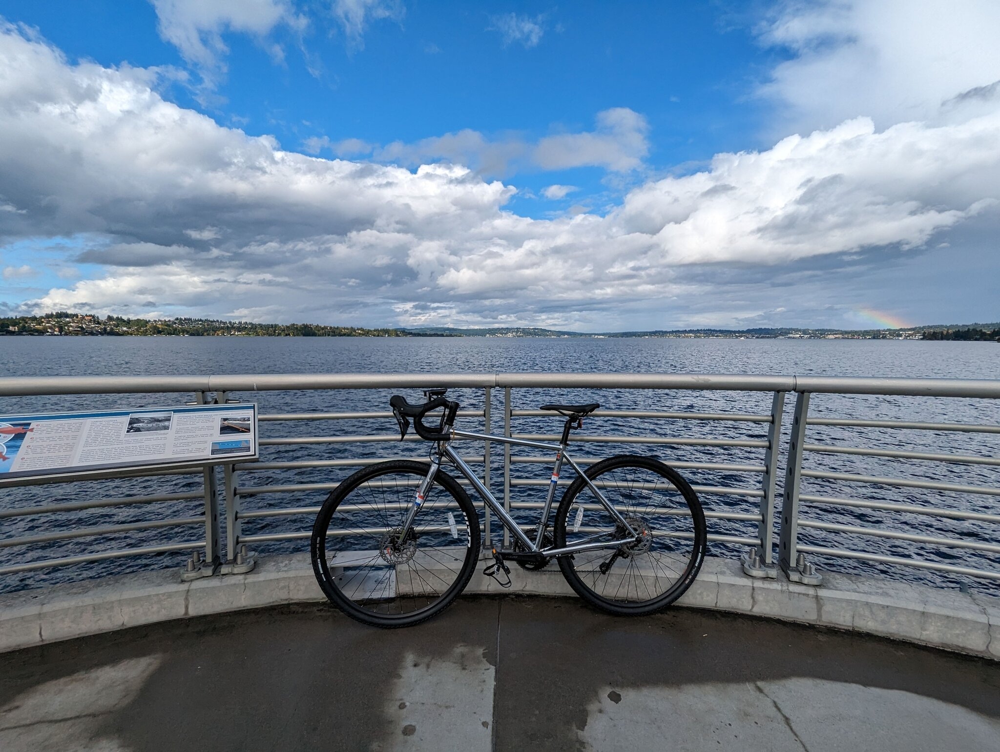
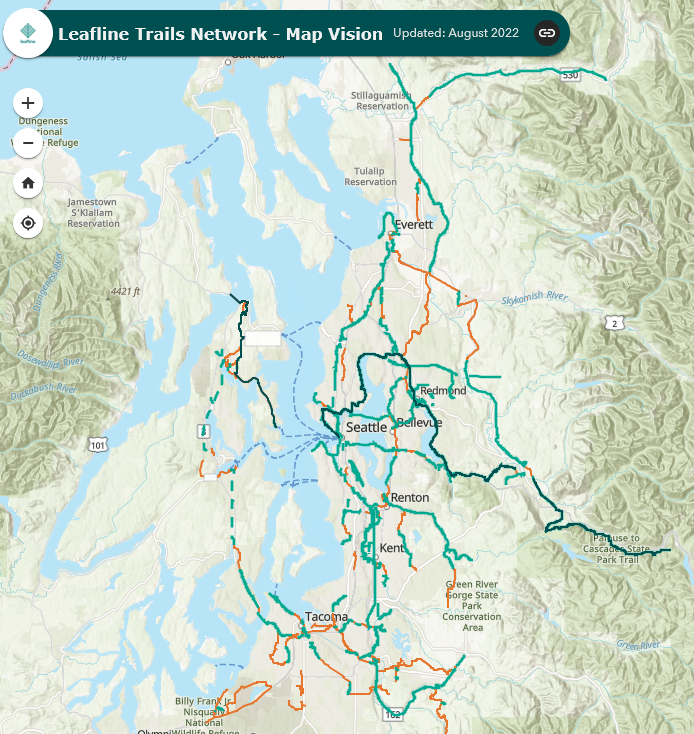
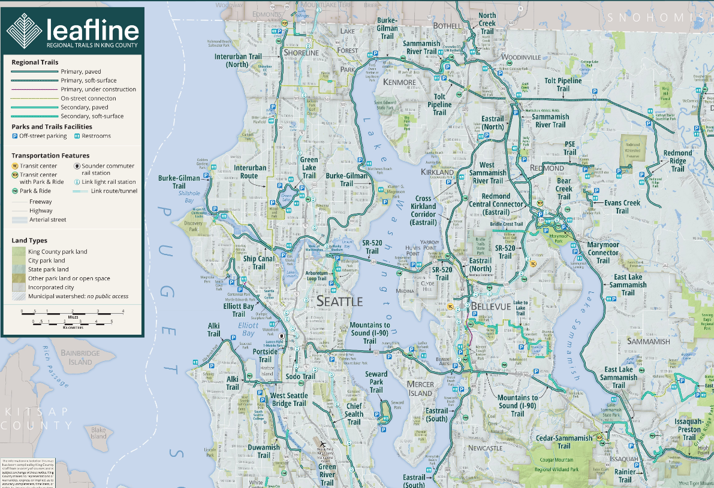
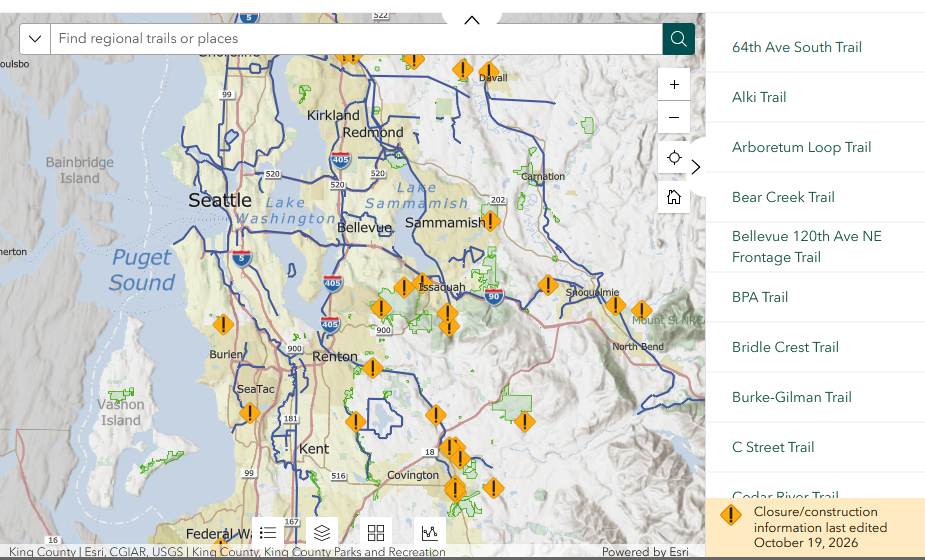
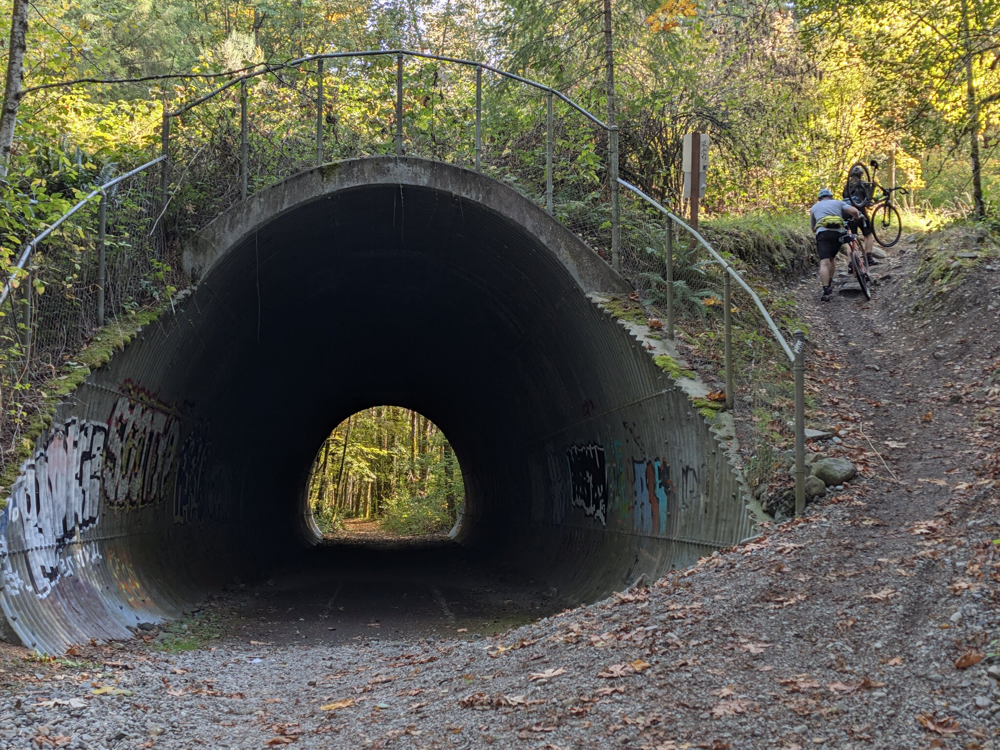
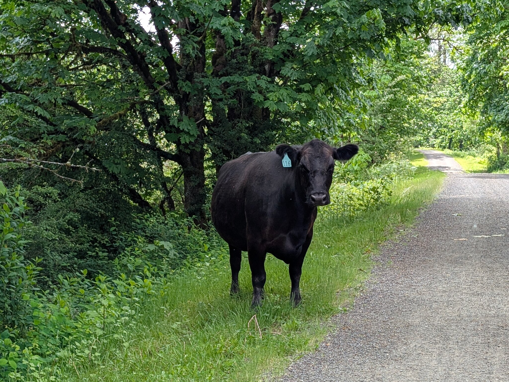

+++
title = "Mapping Seattle's Trails"
date = 2026-10-17T10:14:00-07:00
description = "In search of the ideal trail map"
[taxonomies]
tags = ["maps"]
+++

Seattle's trail network is one of my favorite things about the area. You can bike across the [world's longest floating bridge](https://en.wikipedia.org/wiki/Evergreen_Point_Floating_Bridge), grab a drink at a [train-themed depot](https://chainlinebrewing.com/chainline-returns-to-the-ckc/) on a former railbed, or even see a [scenic 270-foot waterfall](https://www.snoqualmiefalls.com/). All of this can be reached from home or a nearby park.

*My bike on the Evergreen Point (SR-520) floating bridge.*

New segments open every year, and I've been searching for an up-to-date cohesive map.
The [Leafline Trails Coalition](https://leaflinetrailscoalition.wordpress.com/), responsible for efforts to connect much of the 560-mile[^1] trail network, has an [interactive map](https://leafline.maps.arcgis.com/apps/webappviewer/index.html?id=494d8f81569649f5b1bac286748d009c) showing open trail segments. I really like the format for planning out runs and bike rides, but it hasn't been updated since 2022.

*Open trail segments are in green, planned segments are in orange.*

In search of a newer copy, I found that King County has a [cropped view of the network](https://www.arcgis.com/home/item.html?id=1b68852995e5439e9723273b6f6099f7#overview) last updated in 2025. It is **1.2GB (!)** due to an exporting mistake, so here's a smaller 9.3MB copy: [RTMap_2025_rasterized.pdf](RTMap_2025_rasterized.pdf). This version adds some useful features not found in the interactive map like surface type, transit connectivity, and restroom markers.

King County also has the [Backyard FunFinder](https://experience.arcgis.com/experience/26b4c16e5df04456a588454b2b5bc0ee/page/Trails#zoom_to_selection=true), which uses the same ArcGIS mapping software as the Leafline map. The goal, however, is quite different; this map tries to show what's currently open and has alerts for trail conditions. Unfortunately, at the time of writing, it did not show that the Cross-Kirkland Corridor trail is [partly closed](https://www.kirklandwa.gov/Government/Departments/Public-Works-Department/Cross-Kirkland-Corridor/Cross-Kirkland-Corridor-Closures) :disappointed:. 

All of these issues are pretty minor, and combined with bike routing tools, these maps are usually good enough to get by. But recently, I got burned by them on the Snoqualmie Valley Trail at Tokul Tunnel. While the map shows the trail ending at the tunnel, the path continues right through it into rough mountain biking terrain and I nearly got thrown off my bike.

When I backtracked to the tunnel entrance to find the "on-street connection", it turned out to be a steep hike up to a road with no shoulder and no sharrows[^2]. Getting back onto the trail wasn't easy either. The bridge to the next section was closed due to flood damage, and the section after that cut right through a golf course!

*Bikers carry their bikes up a steep embankment on the right side of the tunnel.*

All of this has me searching for a tool that combines all the data into one view. I want something that's up-to-date, detailed, shows current closures, and can be viewed offline. Apps like Strava and Trailforks come close but not for free. The data is out there, I just have to put it together. Stay tuned...

*Curious cow on the Snoqualmie Valley Trail.*

[^1]: According to a [post from Leafline Trails](https://leaflinetrailscoalition.wordpress.com/2025/02/06/leafline-trails-coalition-2024-annual-report/) last year.
[^2]: Those road markings with a bike and chevrons indicating that bikes share the road.
